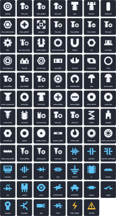

# BinForge

Parametric 3D-printable workshop bin label generator powered by [`build123d`](https://github.com/gumyr/build123d), supporting **Gridfinity Cullenect** (`1U`–`6U`), **Akro-Mils** (`30210`, `30220`, `30230`, `30240`), and **Gladiator** (`small`, `medium`, `large`) storage bins.



---

## Key Features

- **AMS / Multi-Material Ready (`.3mf` & `.step`)**: Packs all raised artwork (icon + title + subtitle) into a single multi-shell `Artwork` body and the plate into a `Base` body so Bambu Studio, OrcaSlicer, and PrusaSlicer import **2 clean objects** per label—or **2 objects total** (`Base` + `Artwork`) for an entire multi-label `batch_plate.3mf`.
- **Supported Bin Systems**:
  - **Gridfinity Cullenect (`cullenect_1u`–`cullenect_6u`)**: `11 mm` tall snap-in labels with `0.40 mm` (2-layer) top/bottom retention grooves.
  - **Akro-Mils (`akro_30210`, `akro_30220`, `akro_30230`, `akro_30240`)**: Stepped side-rail card-slot inserts with raised center islands.
  - **Gladiator (`gladiator_small`, `gladiator_medium`, `gladiator_large`)**: Angled retention-channel bin inserts with stepped side flanges.
- **0.4 mm Nozzle-Safe Icon Library**:
  - **Mechanical** (Profile, Drive/Top-Down, and Combined Profile+Drive `profile+drive` views), **Electrical**, **Safety**, plus drop-in custom `.svg` icons in `icons/`.
- **Fast 2D Dry-Run Linter (`--dry-run`)**: Validates font shrink limits, `0.4 mm` nozzle feature legibility, duplicate filenames, and master build-plate dimensions in milliseconds without running 3D extrusion.
- **Instant SVG & Markdown Previews**: Generates vector plan and isometric `.svg` views alongside `catalog.md`.

---

## Quick Start

```powershell
# Check version
python binforge.py --version

# List all configured bin blank presets and aliases
python binforge.py --list-blanks

# List all Mechanical, Electrical, Safety, and custom .svg icons
python binforge.py --list-icons

# Export visual SVG contact sheet of the entire icon library
python binforge.py --export-icon-catalog

# Dry-run / lint an inventory without writing 3D files
python binforge.py -i examples/fasteners_metric.csv --dry-run

# Generate individual + master build-plate .3mf, .step, .svg, and catalog.md
python binforge.py -i examples/fasteners_metric.csv -o dist/fasteners --plate-width 180
```

---

## Inventory Schema (`.csv` & `.json`)

BinForge accepts either a UTF-8 `.csv` file or a `.json` file (either a top-level array `[...]` or `{"labels": [...]}`). Only the columns/fields you want to override need to be included.

### Field Reference

| Field | Type | Default | Description |
| :--- | :--- | :--- | :--- |
| `blank_type` | `str` | `"cullenect_1u"` | Blank preset ID or alias from [`blanks.json`](blanks.json) (e.g. `cullenect_1u`..`6u`, `akro_30210`..`30240`, `gladiator_small`..`large`). |
| `title` | `str` | `"M3 x 12"` | Primary label line (leave empty `""` for subtitle-only or icon-only labels). |
| `subtitle` | `str` | `"BHCS"` | Secondary label line (leave empty `""` for single-line full-height title). |
| `icon` | `str` | `"bolt"` | Icon name from `--list-icons`, combined `"profile+drive"` (e.g. `"shcs+hex"`), custom `.svg` stem in `icons/`, or `"none"`. |
| `drive_icon` | `str` | `"none"` | Optional drive/recess icon (`"hex"`, `"torx"`, `"phillips"`, `"slot"`, `"square"`, `"pozi"`) automatically paired with `icon` as `icon+drive_icon`. |
| `font_family` | `str` | OS default | Font family (`"Arial"` on Windows, `"Liberation Sans"` on Linux/macOS). |
| `target_title_h` | `float` | `4.2` | Target title height in `mm` (scales automatically on taller Akro-Mils / Gladiator blanks unless explicitly overridden). |
| `target_sub_h` | `float` | `2.8` | Target subtitle height in `mm`. |
| `art_thickness` | `float` | `0.40` | Raised text and icon extrusion thickness in `mm` (`0.40 mm` = 2 layers at `0.20 mm` layer height). |
| `margin_x` | `float` | `2.4` | Horizontal inset margin from the usable face edges in `mm`. |
| `margin_y` | `float` | `1.0` | Vertical inset margin from the top and bottom plate edges in `mm`. |
| `slot_gap` | `float` | `1.5` | Horizontal gap between the icon slot and text block in `mm`. |

### CSV Example ([`examples/fasteners_metric.csv`](examples/fasteners_metric.csv))

```csv
blank_type,title,subtitle,icon
cullenect_1u,M2.5 x 6,SHCS ISO 4762,bolt
cullenect_1u,M3 x 8,SHCS Black Oxide,bolt
cullenect_1u,M3 x 12,BHCS ISO 7380,bolt
cullenect_1u,M3 x 16,Countersunk Torx,screw_torx
cullenect_1u,M3 Locknut,DIN 985 Nyloc,nut
cullenect_1u,M3 Hex Nut,DIN 934 A2-70,nut
cullenect_1u,M3 Flat Washer,DIN 125 A2,washer
cullenect_2u,M5 x 10 + T-Nut,2020 Aluminum Extrusion,bolt
```

### JSON Example ([`examples/electronics_lab.json`](examples/electronics_lab.json))

```json
{
  "labels": [
    {
      "blank_type": "cullenect_1u",
      "title": "10k Ohm",
      "subtitle": "0805 SMD 1%",
      "icon": "resistor"
    },
    {
      "blank_type": "cullenect_1u",
      "title": "100nF 50V",
      "subtitle": "X7R Ceramic",
      "icon": "capacitor"
    },
    {
      "blank_type": "cullenect_2u",
      "title": "LiPo 1S 3.7V",
      "subtitle": "High-Discharge Cells",
      "icon": "warning",
      "art_thickness": 0.60
    }
  ]
}
```

---

## Directory Structure

- [`binforge.py`](binforge.py) — Main CAD/SVG engine, batch build-plate packer, dry-run linter, and CLI
- [`blanks.json`](blanks.json) — Declarative catalog of bin label dimensions, retention features, and aliases
- [`blank_library.py`](blank_library.py) — Pluggable 3D blank geometry builders (`cullenect_groove`, `akro_slot`, `gladiator_slot`, `flat_plate`)
- [`icon_library.py`](icon_library.py) — Unified `0.4 mm` nozzle-safe Mechanical, Electrical, and Safety icon library (Profile, Drive/Top-Down, and Combined Profile+Drive views)
- [`icons/`](icons) — External `.svg` icons and generated visual catalog sheet ([`ICON_CATALOG.svg`](icons/ICON_CATALOG.svg))
- [`examples/`](examples) — Sample `.csv` and `.json` label inventories
- [`tests/`](tests) — Unit and end-to-end 3MF/STEP/SVG regression test suite

## License

Released under the [MIT License](LICENSE).
